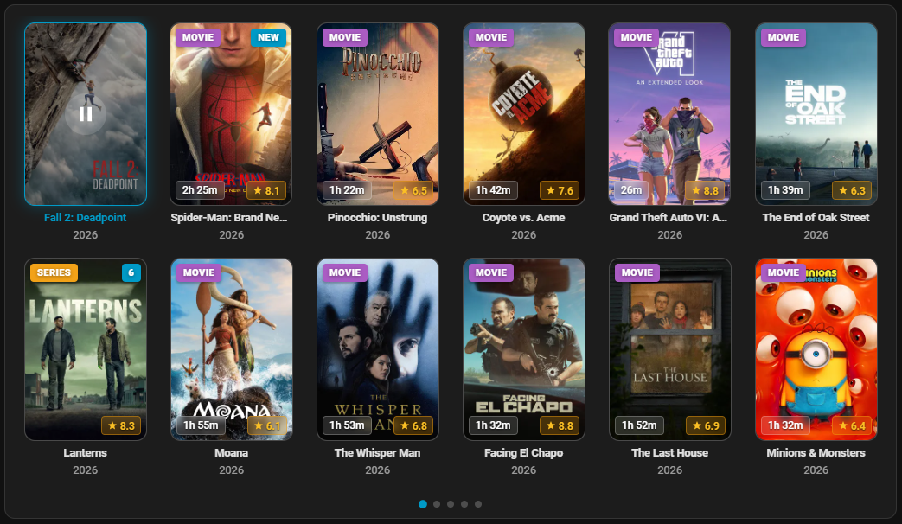

# JellyHA — Jellyfin for Home Assistant

**v1.7.7** · [Full Changelog](https://github.com/zupancicmarko/JellyHA/blob/main/CHANGELOG.md) · [Documentation](https://github.com/zupancicmarko/JellyHA/tree/main/docs)

JellyHA integrates your Jellyfin media server directly into Home Assistant with a full-featured Lovelace card, rich media player entities, and powerful automation sensors.

---

### 🆕 What's new in v1.7.7

- 🔈 **Real-time Volume Synchronization & Tactile Animation** ([#77](https://github.com/zupancicmarko/JellyHA/issues/77)) — Fixed an issue where volume changes made via hardware remotes, physical device buttons, or HA scripts did not reflect on the Now Playing card, and added a smooth tactile spring rebound animation when volume updates.
- 📡 **Chromecast Subtitle Transcoding Optimization** — Fixed playback timeouts on older Chromecast devices when playing items with text subtitles by delivering native WebVTT sidecar streams over HLS instead of forcing heavy video burn-in.

---

### ✨ Features

- 🎬 **Library Card** — Browse movies & shows in Carousel, Grid, or List view with Next Up support
- ⏯️ **Full Playback Control** — Play, pause, stop, seek, shuffle, repeat, volume via `media_player` entities
- 📡 **Chromecast** — Cast with subtitle burn-in and language selection
- 🔍 **Search Service** — Filter by genre, studio, person, and more
- 📊 **Rich Sensors** — Library stats, storage, transcoding streams, connected clients, latest media
- 🤖 **Automation-Ready** — Device triggers, segment events, chapter events, HDR detection
- 🌐 **Multi-Instance** — Multiple Jellyfin servers in one HA instance
- 🃏 **Community Card Compatible** — Works with Mini Media Player, Mushroom, Universal Media Player

---

### 📦 Installation

1. Install via HACS.
2. **Restart Home Assistant**.
3. Go to **Settings → Devices & Services → Add Integration → JellyHA**.
*(Dashboard cards are registered automatically—no manual Lovelace resource entry required!)*

[📖 Full documentation](https://github.com/zupancicmarko/JellyHA/tree/main/docs) · [💬 Community](https://github.com/zupancicmarko/JellyHA/discussions) · [🐛 Issues](https://github.com/zupancicmarko/JellyHA/issues)
